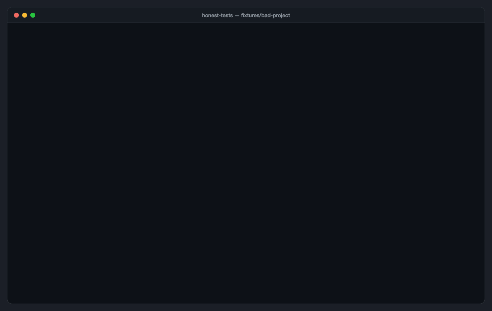

# honest-tests

[](https://github.com/mintwork/honest-tests/actions/workflows/ci.yml) [](https://www.npmjs.com/package/@mintwork/honest-tests) [](https://www.npmjs.com/package/@mintwork/honest-tests#provenance) [](package.json) [](LICENSE) [](https://github.com/mintwork/honest-tests/stargazers)

### Your AI wrote 200 tests. Many of them can't fail.

**honest-tests** is an agent skill + CLI that stops Claude Code, Codex, Cursor and friends from writing
fake tests — and proves which of your existing tests are fake by mutating your code and watching them
stay green.

<p align="center">
  
</p>

```bash
npx @mintwork/honest-tests audit .                       # find tests that can't fail
npx @mintwork/honest-tests mutate src/pricing.ts         # prove it: break the code, see who notices
```

---

## The problem

Ask an agent to "add tests" and you get a wall of green checkmarks. Look closer:

```ts
it('handles multiple items', () => {
  const result = subtotal(items);
  expect(result).toBe(result);                  // compares a value to itself
});

it('applies a percentage discount', () => {
  applyDiscount(100, 10);                       // no assertion at all
});

it('computes the discounted price', () => {
  try {
    expect(applyDiscount(100, 20)).toBe(70);    // WRONG (it's 80) — and still passes
  } catch {}
});

it('gives members free shipping', () => {
  const qualifies = vi.fn().mockReturnValue(true);
  expect(qualifies(10, true)).toBe(true);       // tests the mock it just configured
});
```

Every one of these passes. Coverage goes up. Nothing is verified.

## What honest-tests says about it

```text
$ npx @mintwork/honest-tests audit test/pricing.test.ts

test/pricing.test.ts
  16:5    error   Compares `result` to itself — this can never fail. tautological-assertion
          │ expect(result).toBe(result);
  25:1    error   Test "applies a percentage discount" has no assertions — it can only fail by crashing. no-assertions
          │ it('applies a percentage discount', () => {
  39:7    error   Assertion is inside a try/catch that swallows errors — when it fails, the catch eats the AssertionError and the test passes. swallowed-assertion
          │ expect(applyDiscount(100, 20)).toBe(70); // wrong! but the catch hides it
  53:5    error   Asserts on what mock `qualifies` returns (configured on line 52) — this verifies the mock, not your code. asserts-on-mock
          │ expect(qualifies(10, true)).toBe(true);
  ... 5 more

7 of 10 tests can't fail (or don't test what they claim).
1 file, 10 tests: 7 errors, 2 warnings. Run with --verbose for fixes.
```

Then the killer demo — **mutation testing, built in**. honest-tests flips operators, booleans,
constants and return values in your source (on a temp copy), runs your tests, and shows every change
nobody noticed:

```text
$ npx @mintwork/honest-tests mutate src/pricing.ts

  22 mutants survived — your tests don't actually check these lines:

  src/pricing.ts:15  if (percent < 0 || percent > 100) {
      ✗ `<` → `<=`
      ✗ `||` → `&&`
      ✗ `>` → `>=`
      ✗ `100` → `101`

  src/pricing.ts:22  return isMember || total >= 50;
      ✗ `>=` → `>`
      ✗ `50` → `51`
  ...

  Mutation score: 15.4% (4 killed, 0 timed out, 22 survived of 26; baseline 0.5s)
```

## After: the same code, honest tests

```ts
it('takes the percentage off the amount', () => {
  expect(applyDiscount(200, 25)).toBe(150);
});

it('accepts the 0% and 100% boundaries', () => {
  expect(applyDiscount(200, 0)).toBe(200);
  expect(applyDiscount(200, 100)).toBe(0);
});

it('rejects percentages outside 0..100', () => {
  expect(() => applyDiscount(200, -1)).toThrow(RangeError);
  expect(() => applyDiscount(200, 101)).toThrow(RangeError);
});

it('starts free shipping exactly at 50 for non-members', () => {
  expect(qualifiesForFreeShipping(49.99, false)).toBe(false);
  expect(qualifiesForFreeShipping(50, false)).toBe(true);
});
```

```text
$ npx @mintwork/honest-tests audit test && npx @mintwork/honest-tests mutate src/pricing.ts
✓ 12 tests in 2 files: no fake tests found.
  Mutation score: 100% (26 killed, 0 timed out, 0 survived of 26; baseline 0.5s)
  ✓ Every mutation was caught. These tests actually test something.
```

Both projects live in [`fixtures/`](fixtures) — run `npm run demo:bad` / `npm run demo:good` yourself
(`npm run demo:gif` re-renders the GIF above from the real CLI output).

---

## Install

### Claude Code (plugin + skill)

```text
/plugin marketplace add mintwork/honest-tests
/plugin install honest-tests@honest-tests
```

Or drop just the skill into a repo: `npx @mintwork/honest-tests init claude` (writes `.claude/skills/honest-tests/`).

Then ask: *"write tests for src/cart.ts"* or *"audit my tests"* — or use the slash commands
`/honest-tests:audit [path]` and `/honest-tests:mutate <file>`.

### Codex

```bash
npx @mintwork/honest-tests init codex      # appends an honest-tests section to AGENTS.md (idempotent)
```

### Cursor

```bash
npx @mintwork/honest-tests init cursor     # writes .cursor/rules/honest-tests.mdc (auto-attaches to test files)
```

### Any agent / CI

```bash
npx @mintwork/honest-tests audit . --json                 # machine-readable findings
npx @mintwork/honest-tests audit . --sarif > ht.sarif     # SARIF 2.1.0 for GitHub code scanning
npx @mintwork/honest-tests audit . --changed origin/main  # only test files this branch changed
npx @mintwork/honest-tests mutate src/x.ts --min-score 80 # fail CI below 80% mutation score
```

`--changed <ref>` audits the test files changed since the merge base with `<ref>`, including
uncommitted and untracked files, and reports how many tests the change adds or modifies and how many
of those can't fail (`changed` in the JSON; findings in changed tests carry `change: "added" | "modified"`).
In CI, check out with enough history for the merge base (`actions/checkout` with `fetch-depth: 0`).
Upload `--sarif` output with `github/codeql-action/upload-sarif`; run it from the repository root so
paths line up.

### GitHub Action

Comment on every pull request with what its tests are worth — *"This PR adds 12 tests — 4 can't fail."*:

```yaml
on: pull_request
permissions: { contents: read, pull-requests: write }
jobs:
  honest-tests:
    runs-on: ubuntu-latest
    steps:
      - uses: actions/checkout@v7
        with: { fetch-depth: 0 }
      - uses: mintwork/honest-tests@main   # "Honest Tests Audit"; pin a tag or SHA once released
```

It audits only the test files the PR changes, updates one comment per PR, writes the job summary and
fails the step when a test the PR adds or modifies can't fail (`fail-on: error | warning | never`). It
only parses test files and never runs your code. Code scanning, monorepo and other setups:
[examples/](examples/README.md).

---

## How the skill works

The [skill](skills/honest-tests/SKILL.md) (Agent Skills format) teaches agents one rule — *a test is
honest only if it fails when the behavior it names is broken* — plus two workflows:

- **Writing tests:** name the bug each test catches, derive expected values independently, mock only
  boundaries, cover boundaries and error paths, then self-audit with `audit` + `mutate` before saying
  "done". Hard rules forbid the classic agent moves: weakening assertions to get green, changing the
  expected value to match output, mocking the unit under test, `try/catch` around asserts.
- **Auditing tests**, in phases, like a security audit:
  1. **Detect** — `honest-tests audit --json` plus a manual pass for smells static analysis can't see.
  2. **Verify** — every finding is opened and marked *confirmed / false-positive / accepted*; key
     findings are proven with surviving mutants.
  3. **Report** — "N of M tests can't fail", confirmed findings, surviving mutants, next steps.
  4. **Fix** — only when asked; re-run and show the before/after mutation score.

References the agent loads on demand: [test smell catalog](skills/honest-tests/references/test-smells.md),
[writing honest tests](skills/honest-tests/references/writing-honest-tests.md),
[audit procedure](skills/honest-tests/references/audit-procedure.md),
[mutation testing](skills/honest-tests/references/mutation-testing.md).

## Rules

| Rule | Severity | Catches |
| --- | --- | --- |
| `no-assertions` | error | Test body never asserts — passes unless it crashes |
| `tautological-assertion` | error | `expect(x).toBe(x)`, `expect(f(1)).toBe(f(1))`, `expect(true).toBe(true)`, `toHaveLength(list.length)` |
| `asserts-on-mock` | error | Asserting on the return value of a mock the test configured (`vi.fn().mockReturnValue`, `spyOn`, `vi.mocked`, `.mock.results`) |
| `asserts-on-own-literal` | error | Asserting on a literal the test just built: `const p = { service: 's3' }; expect(p.service).toBe('s3')` — common in runtime "type tests" |
| `never-failing-assertion` | error | `expect(x).toBeTruthy` (never called), bare `expect(x)`, un-awaited `.resolves`/`.rejects`, `typeof x` "defined", `length >= 0`, `{}` truthy |
| `swallowed-assertion` | error | Assertion inside `try` whose `catch` doesn't rethrow |
| `catch-only-assertion` | error | Assertions only in `catch` — passes when nothing throws |
| `mocked-unit-under-test` | error | `vi.mock('./cart')` inside `cart.test.ts`; spying on and replacing the unit's own exports |
| `focused-test` | error | `.only`, `fit`, `fdescribe` left in |
| `excessive-mocking` | warning | 5+ module mocks in one file |
| `snapshot-only` | warning | The only assertion is a snapshot |
| `conditional-assertion` | warning | Assertion behind `if` / `&&` / ternary |
| `reimplemented-algorithm` | warning | Expected value recomputed from the call's own inputs: `expect(total(p, q)).toBe(p * q * 1.2)` |
| `oracle-copied-from-output` | warning | Expected float carries rounding noise (`2.9000000000000004`), so it was copied from the code's output |
| `weak-called-assertion` | info | Bare `toHaveBeenCalled()` on a shared mock whose arguments other tests check (warning when the test checks nothing else) |
| `skipped-test` | warning | `.skip`, `xit`, `xdescribe` |

`npx @mintwork/honest-tests rules` prints the list. Suppress a deliberate case with a reason:

```ts
// honest-tests-disable-next-line no-assertions -- smoke test: module must import cleanly
it('loads', () => { require('../src/plugin'); });
```

(`honest-tests-disable-line <rule>` and file-level `/* honest-tests-disable <rule> */` also work.)

## Mutation check

| Operator | Example |
| --- | --- |
| binary | `>=` → `>`, `<` → `<=`, `===` → `!==`, `+` → `-`, `*` → `/` |
| logical | `&&` ↔ `\|\|` |
| assignment | `+=` ↔ `-=` |
| boolean | `true` ↔ `false` |
| negation | `!x` → `x` |
| number | `50` → `51`, `0` → `1` |
| condition | `if (c)` → `if (true)` / `if (false)` |
| return | `return x` → `return undefined` |

**Safe by design:** the project is copied to a temp dir (`node_modules` symlinked), mutants are written
only to the copy and restored after every run, and the copy is removed at the end — even on Ctrl-C. A red
baseline aborts the run. Only test files that import the target — directly or through other local
modules — are run (vitest/jest), once and with coverage off. Imports through path aliases (`@/lib/x`)
aren't followed yet; pass `--test-cmd` if your tests reach the target that way.

**Fast:** mutants run in parallel, each worker in its own copy (default: half the cores, at most 4;
26 mutants in ~4s on the fixture instead of ~9s). Before trusting parallel runs, the baseline runs in
every copy at once; if that fails (fixed ports, a shared database), it falls back to one worker, so a
suite that isn't parallel-safe can't inflate the score. With 2+ related test files, a **coverage map**
runs each test file once against a probed copy of the target, and each mutant then runs only the test
files that execute its statement; mutants no test executes are reported without a run.

```text
--test-cmd "<cmd>"   custom command; {files} expands to related test files
--max-mutants <n>    cap (default 100)          --timeout <ms>   per-run timeout
--min-score <0-100>  exit 1 below this score    --root <dir>     project root
--concurrency <n>    parallel workers           --coverage-map auto|on|off   (default auto)
```

## CLI reference

```text
honest-tests audit [paths...]   [--json | --sarif] [-v] [--ignore <glob>] [--rule <id>] [--disable <id>]
                                [--changed <ref>] [--fail-on error|warning|never] [--mutate <file> ...]
honest-tests mutate <file>      [--json | --sarif] [--test-cmd <cmd>] [--max-mutants <n>] [--min-score <n>]
                                [--concurrency <n>] [--coverage-map auto|on|off]
honest-tests rules              [--json]
honest-tests init <claude|codex|cursor> [--dir <repo>]
```

Exit codes: `0` clean, `1` findings at/above `--fail-on` (default `error`) or score below `--min-score`,
`2` usage/runtime error. JSON output schema is documented in
[audit-procedure.md](skills/honest-tests/references/audit-procedure.md#phase-1--detect).

## Dogfooding

honest-tests audits its own suite in CI (`npm run dogfood` → zero findings) and mutation-checks its own
rules. While building v1, `mutate src/rules/asserts-on-mock.ts` scored **50%** against our first rule
tests — the tool found the gaps in the tests for the tool. After adding the missing negative cases it's
at 84%, and `never-failing-assertion.ts` is at 100%; the remaining survivors are near-equivalent mutants
such as early-exit optimizations.

## Roadmap

- [ ] **pytest adapter** — the rule engine is language-neutral; an adapter only has to emit the
      `TestFileModel` ([src/adapters/python](src/adapters/python/index.ts) documents the mapping)
- [x] Parallel mutant runs and per-test coverage mapping (run only tests that execute the mutated line)
- [x] SARIF output for GitHub code scanning; `--changed` mode for PR diffs
- [x] More rules: oracle copied from output, re-implemented algorithm in test, weak `toHaveBeenCalled()`
- [ ] Mocha, node:test, Bun, Deno; Go and Rust adapters
- [x] GitHub Action with a PR comment: "this PR adds 12 tests, 4 can't fail"

## Contributing

PRs welcome — especially new rules with a bad/good fixture and pytest adapter work. See
[CONTRIBUTING.md](CONTRIBUTING.md).

## License

[MIT](LICENSE)
