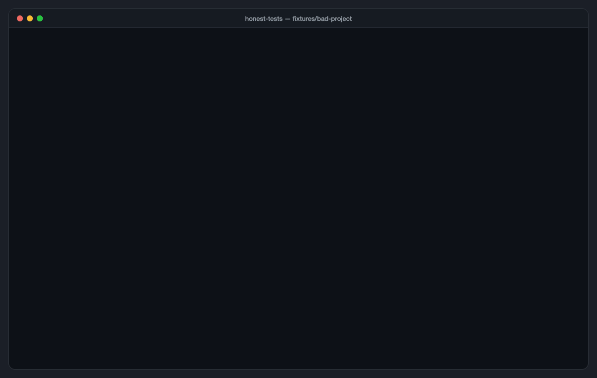

# Honest Tests Audit v0.2.0

**Find the tests a pull request adds that can't fail, and say so in a PR comment.**

honest-tests is an agent skill plus a CLI that finds tests which pass whether or not the code works:
`expect(x).toBe(x)`, tests with no assertions, assertions on a mock's configured return value,
`try/catch` blocks that swallow the failure, and more. Built-in mutation testing then proves which
tests are weak. This release adds a GitHub Action, Python support and four more JS test runners.



## New: the GitHub Action

```yaml
# .github/workflows/honest-tests.yml
name: Honest tests
on: pull_request
permissions:
  contents: read
  pull-requests: write # create/update the PR comment
jobs:
  audit:
    runs-on: ubuntu-latest
    steps:
      - uses: actions/checkout@v7
        with:
          fetch-depth: 0 # the audit diffs against the merge base
      - uses: mintwork/honest-tests@v0
```

It audits only the test files the PR changes and keeps one comment up to date:

> ### Honest Tests Audit
>
> **This PR adds 12 tests — 4 can't fail.**
>
> | Severity | Change | Test | Finding | Location |
> | --- | --- | --- | --- | --- |
> | error | added | applies a discount | Assertion is inside a try/catch that swallows errors … `swallowed-assertion` | `test/pricing.test.ts:39` |

- It fails the step only for findings in tests the PR adds or modifies (`fail-on: error | warning |
  never`). Findings in tests the PR didn't touch are listed, but they don't fail the step.
- It writes the same report to the job summary. It can also write SARIF (`sarif-file`) for GitHub code
  scanning.
- It only parses test files. It never installs your dependencies or runs your code, so it's safe on
  pull requests from forks. Fork PRs get a read-only token, so the comment is skipped there and the
  job summary still has the report.
- Inputs, outputs and permissions are in the
  [README](https://github.com/mintwork/honest-tests#github-action-honest-tests-audit). Code scanning and
  monorepo setups are in [examples/](https://github.com/mintwork/honest-tests/tree/main/examples).

## CLI: SARIF and `--changed`

```bash
npx @mintwork/honest-tests audit . --changed origin/main  # only test files this branch changed
npx @mintwork/honest-tests audit . --sarif > ht.sarif     # SARIF 2.1.0 for code scanning
```

- `--changed <ref>` audits the test files changed since the merge base, including uncommitted and
  untracked files. It reports how many tests the change adds or modifies, and how many of those can't
  fail.
- `--sarif` reports findings, and surviving mutants when mutation runs, as SARIF results.

## 3 new rules (16 in total)

These rules are tuned to miss cases rather than raise false alarms.

- `reimplemented-algorithm` (warning): the expected value repeats the arithmetic on the call's own
  inputs, e.g. `expect(total(p, q)).toBe(p * q * 1.2)`.
- `oracle-copied-from-output` (warning): the expected value is a float with rounding noise, e.g.
  `2.9000000000000004`, so it was copied from the code's output.
- `weak-called-assertion` (info): a bare `toHaveBeenCalled()` on a shared mock whose arguments other
  tests check. It's a warning when that's the only kind of check in the test.

## Faster mutation testing

- **Parallel mutants:** each worker runs in its own project copy. The default is half the CPU cores,
  at most 4 (`--concurrency`). The fixture's 26 mutants take about 4 s instead of about 10 s. If the
  suite fails when it runs in several copies at once (fixed ports, a shared database), the run falls
  back to one worker, so false kills can't inflate the score.
- **Coverage map:** with 2 or more related test files, each mutant runs only the test files that
  execute its line. Mutants that no test executes are reported without a run (`--coverage-map
  auto|on|off`).

## More runners: Mocha, node:test, Bun and Deno

- `audit` understands their test and assertion styles, e.g. `t.test` subtests, `t.assert.*`,
  `this.skip()`, `bun:test` mocks, `Deno.test`, `t.step` and `@std/assert`.
- `mutate` runs the related test files with `mocha`, `node --test`, `bun test` or `deno test`.

## Python: the pytest adapter

`audit` now checks pytest and unittest files (`test_*.py`, `*_test.py`). It understands `assert`,
`pytest.raises`, `self.assert*`, `Mock` / `patch` / `mocker` / `monkeypatch` and skip markers. It also
catches Python-only bugs:

- `assert (x == 1, "msg")`: a tuple is always truthy.
- `assert m.called_once_with(1)`: this isn't a Mock assertion. It returns a truthy child mock.

Python's own `ast` module parses the files, and the audited code is never imported or run.

Limitations:

- The adapter needs `python3` 3.9 or later on `PATH`. Without it, Python files are listed as
  unsupported.
- The 3 new rules are JS/TS-only for now.
- Mutation testing is JS/TS-only.

## Install

```bash
npx @mintwork/honest-tests audit .               # CLI, Node 22+
npx @mintwork/honest-tests init claude           # agent skill into .claude/skills/
```

Full changelog: [CHANGELOG.md](https://github.com/mintwork/honest-tests/blob/main/CHANGELOG.md#020---2026-11-15)
